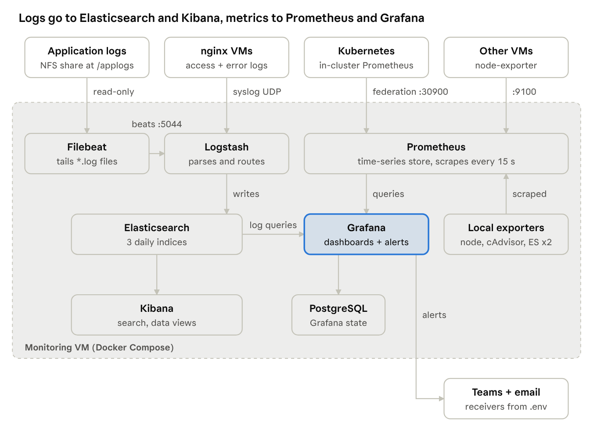

# Monitoring Stack – Setup & Operations

Nov 21, 2026

## Overview

One Ubuntu/Debian VM runs the whole monitoring stack in Docker: metrics (Prometheus + Grafana) and logs (Filebeat, Logstash, Elasticsearch, Kibana). Everything is configured from one file, `.env`, and started by one script, `monitoring_setup.sh`.

- **Repository:** [github.com/Samvelx9/monitoring](https://github.com/Samvelx9/monitoring) (branch `master`)
- **Metrics from:** the monitoring VM itself, other VMs (node-exporter), the Kubernetes cluster (federation from an in-cluster Prometheus), Elasticsearch clusters
- **Logs from:** application log files on NFS (`/applogs`) and nginx (syslog)
- **Alerts:** Grafana unified alerting to Microsoft Teams and email
- **Install guide:** the repository [README.md](../README.md) (step-by-step commands); this document explains how the setup works and how to operate it

## Architecture



Grafana is the single place to look: it reads metrics from Prometheus and logs from Elasticsearch, and sends alerts. Kibana is for searching raw logs. The second Elasticsearch exporter scrapes the application Elasticsearch in Kubernetes (`KUBEMASTER_IP:ELASTICSEARCH_NODEPORT`).

| Port | Service | Opened to |
| --- | --- | --- |
| 3000 | Grafana | Users |
| 5601 | Kibana | Users |
| 9090 | Prometheus | Users (optional) |
| 5044 | Logstash beats input | Local Filebeat |
| 5045 TCP/UDP | Logstash, nginx access syslog | nginx VMs |
| 5046 TCP/UDP | Logstash, nginx error syslog | nginx VMs |
| 9200, 9300 | Elasticsearch | Local |
| 5432 | PostgreSQL (Grafana DB) | Local |
| 9100 | node-exporter | Local |
| 8080 | cAdvisor | Local |
| 9114, 9115 | Elasticsearch exporters (monitoring, application) | Local |

## Repository layout

Only `.env` is edited by hand. Three config files are generated from `templates/` on every run of the script and are ignored by git.

| Path | Purpose | Edited by |
| --- | --- | --- |
| `.env` | All settings: IPs, passwords, alert receivers, SMTP, memory | You |
| `monitoring_setup.sh` | One-step setup: checks, config generation, start, post-setup | Nobody |
| `docker-compose.yml` | All services, ports, volumes; reads values from `.env` | Rarely |
| `templates/prometheus.yml` | Source of `prometheus/prometheus.yml` (scrape jobs, federation, VM targets) | Rarely |
| `templates/contactpoints.yml` | Source of Grafana contact points (Teams, email) | Rarely |
| `templates/elasticsearch-datasource.yml` | Source of Grafana's Elasticsearch data source | Rarely |
| `prometheus/prometheus.yml` | Generated | Script |
| `grafana/provisioning/alerting/contactpoints.yml` | Generated | Script |
| `grafana/provisioning/datasources/elasticsearch.yml` | Generated | Script |
| `grafana/grafana.ini` | Grafana base config; secrets and domain come from `.env` via `GF_*` variables | Rarely |
| `grafana/provisioning/dashboards/` | 66 dashboards; each folder becomes a Grafana folder | When adding dashboards |
| `grafana/provisioning/alerting/` | Alert rules, notification policy, message templates | When adding alerts |
| `logstash/pipeline/` | `input.conf`, `filter.conf`, `output.conf` | When changing parsing |
| `logstash/patterns/` | Grok patterns for app logs (`applogs`) and nginx (`nginxlogs/nginx`) | When log formats change |
| `filebeat/config/filebeat.yml` | Which log files are read | Rarely |
| `elasticsearch/config/` | `elasticsearch.yml`, `jvm.options` | Rarely |
| `kibana/` | `Dockerfile` (adds `jq`), `start-kibana.sh` (gets the service token), `kibana.yml` | Rarely |
| `setup/` | Optional one-off Elasticsearch users/roles job (profile `setup`, not used by default) | No |

On the host, data lives outside the repo: `/data/elasticsearch`, `/data/prometheus`, `/data/postgres`, and logs are read from `/applogs`.

## Configuration (.env)

Every value is wrapped in single quotes; a value must not contain `'`. The script refuses to start while a required value is empty.

| Variable | Required | Meaning | Example |
| --- | --- | --- | --- |
| `MONITORING_IP` | Yes | IP of the monitoring VM; used as Grafana's domain and in printed links | `10.0.0.50` |
| `KUBEMASTER_IP` | Yes | Kubernetes master; federation target (`:30900`) and application Elasticsearch host | `10.0.0.10` |
| `ELASTICSEARCH_NODEPORT` | Yes | NodePort of the application Elasticsearch service | `30920` |
| `SERVERS` | No | Other VMs to scrape with node-exporter, `IP:role` separated by spaces; not kube nodes | `10.0.0.21:nfs 10.0.0.24:nginx` |
| `ELASTIC_PASSWORD` | Yes | `elastic` user: Kibana login, Logstash, Grafana data source, exporter. Letters and digits only | `Ab12Cd34` |
| `GRAFANA_ADMIN_PASSWORD` | Yes | Grafana `administrator` password; re-applied on every run | |
| `POSTGRES_PASSWORD` | Yes | Password of Grafana's PostgreSQL database. Letters and digits only | |
| `TEAMS_WEBHOOK` | Yes | Teams webhook for the `critical` and `warning` contact points | |
| `ALERT_EMAIL` | Yes | Address of the `projectemail` contact point | `project-alerting@synisys.com` |
| `SMTP_HOST` | Yes | Mail server `host:port` | `email.synisys.com:25` |
| `SMTP_USER` | Yes | SMTP login and sender address | `grafana@synisys.org` |
| `SMTP_PASSWORD` | Yes | SMTP password | |
| `SMTP_FROM_NAME` | No | Sender name in alert emails | `PROJECT-Grafana` |
| `ELASTIC_VERSION` | No | Version of Elasticsearch, Logstash, Filebeat, Kibana | `8.9.1` |
| `ELASTIC_MEMORY` | No | Elasticsearch heap (about 1/4 of RAM) | `4g` |
| `LOGSTASH_MEMORY` | No | Logstash heap | `1g` |
| `PROMETHEUS_RETENTION` | No | How long metrics are kept | `720h` (30 days) |
| `PROMETHEUS_MEMORY` | No | Prometheus container memory limit | `6gb` |

The tuning defaults fit a VM with 16 GB RAM. `ELASTIC_PASSWORD` and `POSTGRES_PASSWORD` are applied only on the first start; to change them later see Operations.

## What monitoring_setup.sh does

Run it as root from the repo folder: `bash monitoring_setup.sh`. It asks nothing and is safe to run any number of times; a re-run applies `.env` changes and takes under a minute when images are present.

1. **Checks** — root user, Docker and `docker compose`, `envsubst`, `.env` present, every required value filled, both database passwords letters and digits only. `/applogs` empty or missing gives a warning.
2. **Host settings** — raises `vm.max_map_count` to 262144 only if it is lower (saved in `/etc/sysctl.d/99-elasticsearch.conf`).
3. **Data folders** — creates `/data/elasticsearch` (owner 1000), `/data/prometheus` (65534), `/data/postgres` (999, mode 700).
4. **Config generation** — renders the three templates with values from `.env`; builds one node-exporter target per `SERVERS` entry; sets ownership of `./grafana` to 472.
5. **Start** — `docker compose up -d --build` (only Kibana is built; all other services use upstream images), then restarts Grafana and Prometheus so they load the freshly generated configs.
6. **Wait** — until Elasticsearch health is green/yellow (600 s), Grafana database is ok (300 s), Kibana status is available (600 s), Prometheus is ready (120 s). A timeout stops the script and names the container to check.
7. **Post-setup** — sets the Grafana admin password; creates Kibana data views `logstash*`, `nginx-access*`, `nginx-error*` (skipped if present); opens ports 3000, 5601, 9090, 5044, 5045, 5046 when ufw is active.
8. **Report** — checks node-exporter on every `SERVERS` VM and the Kubernetes Prometheus on `KUBEMASTER_IP:30900` (warnings only), prints container status and the Grafana, Kibana and Prometheus links.

Output lines are marked `[ OK ]`, `[WARN]` or `[FAIL]`. Any `[FAIL]` stops the script with exit code 1.

## Installation

The README in the repository has every command; the order and the prerequisites are summarised here.

**Monitoring VM:** Ubuntu 22.04/24.04 or Debian 13, 4 CPU, 16 GB RAM, 100 GB disk, root access, internet (or see offline install). The full set of images takes about 8 GB of disk.

1. Install `git nfs-common curl ca-certificates gettext-base` and Docker with the compose plugin.
2. Mount the NFS log share on `/applogs` (read-only, `_netdev`, in `/etc/fstab`).
3. Clone the repo to `/opt/monitoring`.
4. Fill in `.env`.
5. On the Kubernetes master, install the in-cluster Prometheus that this stack federates from:

   ```bash
   helm upgrade -i prometheus oci://registry.synisys.com/infrastructure/prometheus --version=16.0.2 --set alertmanager.enabled=false --set server.service.type=NodePort --set server.service.nodePort=30900 --set server.persistentVolume.enabled=false --namespace=monitoring --create-namespace
   ```
6. On every VM listed in `SERVERS`, install node-exporter (`apt-get install prometheus-node-exporter`, port 9100).
7. Run `bash monitoring_setup.sh`.
8. Open Grafana (`http://<MONITORING_IP>:3000`, user `administrator`) and Kibana (`http://<MONITORING_IP>:5601`, user `elastic`).

**Network access needed:** the monitoring VM must reach `KUBEMASTER_IP:30900`, `KUBEMASTER_IP:ELASTICSEARCH_NODEPORT` and port 9100 on every `SERVERS` VM. nginx VMs must reach the monitoring VM on UDP 5045/5046.

## Log pipeline

Three inputs on Logstash become three daily indices in Elasticsearch; each event goes to exactly one index.

| Source | Transport | Logstash input | Index | Kibana data view |
| --- | --- | --- | --- | --- |
| Application log files | Filebeat (beats) | TCP 5044 | `logstash-YYYY.MM.DD` | `logstash*` |
| nginx access log | syslog | TCP/UDP 5045 | `nginx-access-YYYY.MM.DD` | `nginx-access*` |
| nginx error log | syslog | TCP/UDP 5046 | `nginx-error-YYYY.MM.DD` | `nginx-error*` |

### Application logs

- **Files read:** `/applogs/*/*/*/logs/*.log`, i.e. `/applogs/<environment>/<service>/<version>/logs/<file>.log`.
- **Folder names** may contain only letters, digits, `_` and `-`. A version folder like `1.2.3` breaks path parsing (the service, environment and version fields stay empty); use `v1` or `1-2-3`.
- **Only fresh files:** Filebeat skips files not changed in the last 20 minutes (`ignore_older: 20m`) and closes idle files after 5 minutes.
- **Multiline:** a line that does not start with `YYYY-MM-DD` is joined to the previous event (stack traces).
- **Line format** (pattern `APPLOG`): `<date time,ms> <host> <app> <traceId> <spanId> <LEVEL> <thread> <class> <message>`.
- **Fields produced:** `app.loglevel`, `app.logmessage`, `app.name`, `app.hostname`, `app.traceid`, `app.spanid`, `app.threadname`, `app.classname`, and from the path `app.environment`, `app.service.name`, `app.service.version`.
- **Timestamp:** read from the line in the `Asia/Yerevan` time zone.

### nginx logs

On each nginx VM, inside `http { }`:

```nginx
access_log syslog:server=<MONITORING_IP>:5045,tag=nginx_access main;
error_log  syslog:server=<MONITORING_IP>:5046,tag=nginx_error;
```

`main` is the standard Synisys `log_format` (begins with `$time_local_w_ms $realip_remote_addr - $remote_user $host "$request"`). Logstash can parse only that format (pattern `NGINXACCESS`), never nginx's default `combined`. nginx sends syslog over UDP, so UDP 5045/5046 must be open. Parsed fields include `status_code`, `request_time`, `upstream_response_time`, `bytes_sent`, `nginx.service.name`, `nginx.app.name`, `nginx.request_id`, trace ids and `public_ip_1/2`. The access-log timestamp is parsed as UTC.

## Grafana: data sources, dashboards, alerts

Everything in Grafana is provisioned from files in the repo, so a fresh install comes up with 2 data sources, 66 dashboards and 21 alert rules. Grafana stores its state in the PostgreSQL container (`/data/postgres`).

### Data sources

| Name | UID | Points to | Notes |
| --- | --- | --- | --- |
| Prometheus | `000000001` | `http://prometheus:9090` | Default data source |
| elasticsearch | `000000006` | `http://elasticsearch:9200`, all indices | User `elastic`, password from `.env` |

### Prometheus scrape jobs

| Job | Targets |
| --- | --- |
| `Servers` | node-exporter on the monitoring VM + every `SERVERS` entry (label `service` = role) |
| `cadvisor` | Containers on the monitoring VM |
| `prometheus` | Prometheus itself |
| `federate` | Everything from the in-cluster Prometheus at `KUBEMASTER_IP:30900` (15 s interval, 14 s timeout) |
| `elasticsearch_exporter` | Monitoring Elasticsearch (`environment=monitoring`) and application Elasticsearch (`environment=application`) |

### Dashboards

Each folder under `grafana/provisioning/dashboards/` becomes a Grafana folder; dashboards are read-only in the UI (`allowUiUpdates: false`) and re-read every 10 s. To change one, export it, replace the JSON file in the repo and push.

| Folder | Dashboards |
| --- | --- |
| `core_dashboards` | 25 (Node Exporter Full, Docker containers, RabbitMQ, Redis, PostgreSQL, SLOs, Elasticsearch, …) |
| `01._Platform_Overview` | 5 |
| `02._Microservices_Performance` | 4 |
| `03._Caching__Internal_Metrics` | 4 |
| `04._Service_Communication__Traffic` | 2 |
| `06._Infrastructure__Resource_Utilization` | 3 |
| `09._Client_Reports` | 1 |
| `10.0._<service>` (11 folders) | 16 |
| `11._RabbitMQ`, `11.0_RabbitMQ` | 2 + 2 (same two dashboards twice) |
| `12._Lexvue` | 2 |

### Alert rules

All rules live in folder `alerting`, group `10s`. Severity decides the route.

| Severity | Rules |
| --- | --- |
| critical | All Servers, CPU usage, RAM usage, DISK USAGE, Kubernetes Nodes, Kube NODE ready, Kube Cert Expire, PV utilization, Prometheus, PostgreSQL UP, Redis, RabbitMQ, Consul, Nginx, Hikari ACTIVE Connections |
| warning | Microservice availability, GC collection time, No RabbitMQ consumer, RabbitMQ Queue limit, Application log count, NGINX-ACCESS log count |

The two log-count rules query Elasticsearch; all others query Prometheus.

### Notification routing

| Severity | Teams (`critical` / `warning` contact point) | Email (`projectemail`) |
| --- | --- | --- |
| critical | Immediately, default timing (wait 1 m, repeat 15 m) | Grouped once a day |
| warning | Wait 1 m, group 5 m, repeat 1 h | Grouped once a day |
| none | — | Default receiver |

Message title and body come from the templates `title`, `message` and `alert` (summary annotation of each alert).

## Operations

Almost every change is: edit `.env`, run `bash monitoring_setup.sh`. Never edit the generated files; the next run overwrites them.

| Task | How |
| --- | --- |
| Change IPs, alert receivers, SMTP, Grafana admin password, memory, retention | Edit `.env`, run the script |
| Add or remove a monitored VM | Install node-exporter on it, edit `SERVERS` in `.env`, run the script |
| Change `ELASTIC_PASSWORD` | Set it in Elasticsearch first (below), then `.env`, then run the script |
| Change `POSTGRES_PASSWORD` | Set it in PostgreSQL first (below), then `.env`, then run the script |
| Update the repo | `git pull` in `/opt/monitoring`, run the script |
| Add a dashboard or alert rule | Add the file under `grafana/provisioning/`, push, pull on the VM, run the script |
| Stop / start everything | `docker compose down` / `docker compose up -d` (data in `/data` is kept) |
| Look at a service | `docker compose ps`, `docker compose logs --tail=50 <service>` |

### Change ELASTIC_PASSWORD

```bash
cd /opt/monitoring
source .env
NEW_PASSWORD='NewPassword123'
curl -s -u "elastic:$ELASTIC_PASSWORD" -X POST localhost:9200/_security/user/elastic/_password \
  -H 'Content-Type: application/json' -d "{\"password\":\"$NEW_PASSWORD\"}"
```

The output must be `{}`. Put the same value in `.env` and run the script: Logstash, Kibana and the exporter are recreated with it, and Grafana's data source is regenerated.

### Change POSTGRES_PASSWORD

```bash
cd /opt/monitoring
NEW_PASSWORD='NewPassword123'
docker compose exec -T postgres psql -U grafana -d grafana -c "ALTER USER grafana WITH PASSWORD '$NEW_PASSWORD';"
```

The output must be `ALTER ROLE`. Put the same value in `.env` and run the script.

### Offline install

On a machine with internet, `docker pull` and `docker save` these images, copy the archive and `docker load` it on the server:

`prom/node-exporter:v1.3.1`, `prometheuscommunity/elasticsearch-exporter:v1.5.0`, `woodliu268/cadvisor:v0.43.0`, `grafana/grafana:12.3.3`, `prom/prometheus:v3.9.1`, `postgres:18.2`, `docker.elastic.co/elasticsearch/elasticsearch:8.9.1`, `docker.elastic.co/beats/filebeat:8.9.1`, `docker.elastic.co/logstash/logstash:8.9.1`, `docker.elastic.co/kibana/kibana:8.9.1`.

Kibana is built (`apt-get install jq`), so build it online with `docker compose build kibana` and save the resulting image too. To use a private registry instead, change the image names in `docker-compose.yml` and the `FROM` line in `kibana/Dockerfile`.

## Troubleshooting

Start with `docker compose ps` and `docker compose logs --tail=50 <service>` in `/opt/monitoring`.

| Symptom | Cause | Fix |
| --- | --- | --- |
| Script: `Fill in these values in .env` | Required value empty | Fill it in, run again |
| Script: `<service> is not ready after Ns` | Container failing to start | Read that container's log |
| Elasticsearch `failed to retrieve password hash`, Kibana `security_exception` | Disk above 90–95 % (watermarks) | Free disk; the VM needs about 8 GB for images plus data |
| Kibana "server is not ready yet" for minutes | Elasticsearch still starting | `start-kibana.sh` retries every 5 s; wait, or check Elasticsearch |
| `[WARN] Kubernetes Prometheus does not answer` | In-cluster Prometheus missing or port 30900 blocked | Run the helm command, open the port |
| `[WARN] node-exporter on <ip> does not answer` | node-exporter missing or port 9100 blocked | Install it, open the port |
| No app logs in Kibana | No file changed in the last 20 min, wrong folder layout, or NFS hang | `ls /applogs/*/*/*/logs/`; test a file with `timeout 15 head -c1 <file>` |
| App logs arrive but service/environment/version are empty | Dots in a path folder name (`1.2.3`) | Use `[A-Za-z0-9_-]` folder names |
| Every grok field becomes a 2-item array | A backup file (`*.bak`) left in `logstash/pipeline/` is loaded as a second pipeline | Keep backups outside that folder |
| No nginx logs | UDP 5045/5046 blocked or nginx not using `main` format | Open UDP ports, use `main` |
| Grafana Elasticsearch data source 401 | `.env` password differs from Elasticsearch | Follow "Change ELASTIC_PASSWORD" |
